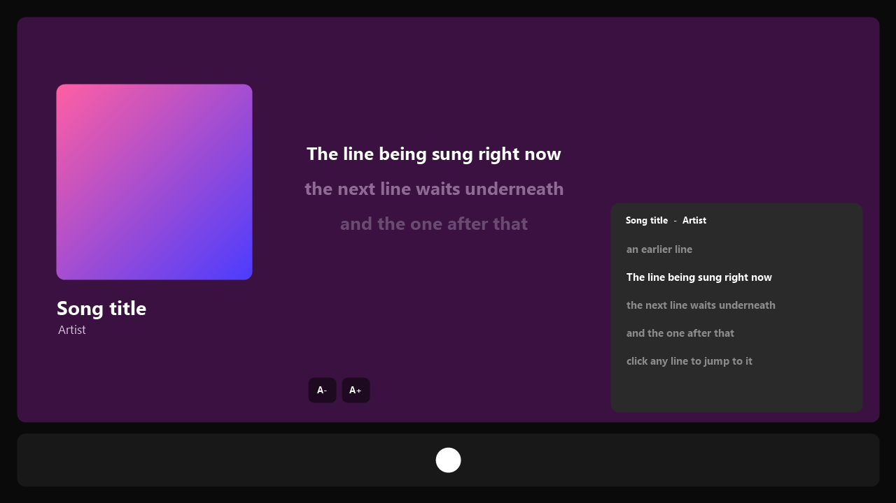

# Lyrics Plus (Juxtaposed Edition)



Spicetify's Lyrics Plus with a song-info panel, text size buttons and a small lyrics pop-up.

A modified copy of the [Lyrics Plus](https://github.com/spicetify/cli/tree/main/CustomApps/lyrics-plus) custom app that ships with [Spicetify](https://spicetify.app). Everything the original does is still here: synced, unsynced and karaoke lyrics, the same providers, translation and romanization.

> The preview above is an illustration of the layout, not a screenshot.

## ✨ What's different

- **Song-info panel.** The lyrics page shows a large cover with the title, artist and album beside the lyrics. Windows narrower than 1100px keep the original full-width layout.
- **A− / A+ buttons.** Change the lyrics size in one click. Ctrl + mouse wheel still works.
- **One lyrics button.** The player bar's lyrics button opens the lyrics page and takes you back when clicked again, like Spotify's own. It replaces the separate Lyrics icon in the top bar.
- **Mini player.** Right-click the lyrics button, or use the mini player button on the lyrics page, for a mini player with the cover, song, progress bar, shuffle, previous, play, next, repeat, a like button, a volume slider and synced lyrics. Click a line to jump to it.
  - **Drag it anywhere** by its top bar, and **resize it** from the bottom-right corner. It remembers where you left it.
  - **Three layouts that follow its size**, like a desktop mini player: **Compact** (short and wide: small cover and controls), **Expanded** (square: big cover) and **Lyrics** (tall: lyrics fill the space).
  - **Keep on top**: pops the mini player out into its own always-on-top window, using the same feature as Spotify's own mini player. Drag it by its top bar, snap it to a corner from the ··· menu, and resize it to switch layouts.
  - **Full screen**: cover, song and controls on the left and lyrics on the right (or stacked on a portrait screen), covering everything including the player bar. Spotify's own full screen button opens it too. Press Esc to leave.
  - **Lyrics as written, romanized, or both**: for Japanese, Korean and Chinese songs, show the original, the romanized version (for example "kampeki de usotsuki na kimi wa"), or both, from the ··· menu.
  - **Controls on hover**: turn on **Show only on hover** in the ··· menu to hide the controls until you point at the player, in the mini player and in full screen.
  - **Background**: choose **Dynamic color** (from the cover), **Album cover** (blurred) or **Static color** from the ··· menu, where the lyrics size is too.
- **Calmer colours.** With "Colorful background" on, the page keeps the song's colour but darkened, so a vivid cover doesn't flood the screen.
- **Player bar button on by default.** It replaces Spotify's own lyrics button. Turn it off under **Lyrics Plus config**.

The pop-up reads lyrics from Spotify first and [LRCLIB](https://lrclib.net) second. It does not use the other providers or translations; open the full page for those.

## 📦 Install

### Marketplace

Find **Lyrics Plus (Juxtaposed Edition)** in Marketplace's **Apps** tab. Marketplace lists custom apps and links to their installation instructions; it cannot install this custom app in one click.

### Manual

1. Download this repo and copy the `lyrics-plus` folder into your Spicetify `CustomApps` folder.

   | Platform        | Path                             |
   | --------------- | -------------------------------- |
   | **Windows**     | `%appdata%\spicetify\CustomApps\` |
   | **Linux/macOS** | `~/.config/spicetify/CustomApps/` |

2. Run:

   ```
   spicetify config custom_apps lyrics-plus
   spicetify apply
   ```

A `lyrics-plus` folder in your own `CustomApps` folder takes priority over the copy bundled with Spicetify, so this replaces the stock app without touching Spicetify's files.

## Updates (Windows)

Marketplace installs use Marketplace's **Installed → Update** action when an update is available. Custom apps can be discovered in Marketplace, but Lyrics Plus still needs the manual installation above.

For manual installs, download [update.ps1](update.ps1) and run it with PowerShell:

```powershell
# Update this project once
powershell -NoProfile -ExecutionPolicy Bypass -File .\update.ps1
# Enable a daily automatic update while signed in
powershell -NoProfile -ExecutionPolicy Bypass -File .\update.ps1 -EnableAutoUpdate
# Check without changing files
powershell -NoProfile -ExecutionPolicy Bypass -File .\update.ps1 -CheckOnly
# Stop automatic updates
powershell -NoProfile -ExecutionPolicy Bypass -File .\update.ps1 -DisableAutoUpdate
```

Use `-Component Both` on these commands to manage the theme and Lyrics Plus together. Only existing manual-install folders are updated. Updates come from the latest published GitHub release, skip an unchanged release commit, and run `spicetify apply` only after downloading changed files; this may reload Spotify. Backups are retained in a `juxtaposed-*` folder in Windows' temporary directory. Failed updates restore the original source files; errors are recorded in `%LOCALAPPDATA%\SpicetifyJuxtaposedUpdater\errors.log`. The scheduled updater runs as your current user without administrator privileges.

## ⚙️ Settings

Open the lyrics page, click your profile picture and choose **Lyrics Plus config**. Two options are new:

| Option              | What it does                                                   |
| ------------------- | -------------------------------------------------------------- |
| **Playbar button**  | Shows the lyrics button in the player bar (opens the pop-up)   |
| **Song info panel** | Shows the cover, title and artist beside the lyrics            |

## 🗑️ Uninstall

Delete the `lyrics-plus` folder you copied and run `spicetify apply`. Spicetify goes back to its bundled Lyrics Plus. To remove Lyrics Plus entirely:

```
spicetify config custom_apps lyrics-plus-
spicetify apply
```

> [!NOTE]
> Based on the Lyrics Plus shipped with Spicetify 2.45.3, tested on Spotify 1.3.4 on Windows and checked against 1.3.5. It does not pick up later fixes to the original automatically. On Spotify 1.3.4 and 1.3.5 the player bar button only appears when something restores the element names that version removed, which the [Juxtaposed](https://github.com/superC12/spicetify-juxtaposed) theme does.

## 💡 Credits and license

Lyrics Plus is part of [Spicetify CLI](https://github.com/spicetify/cli), written by its contributors. This repo changes `index.js`, `Settings.js`, `PlaybarButton.js`, `Pages.js`, `TabBar.js`, `Utils.js` and `style.css`; every other file in `lyrics-plus` is unmodified.

Like Spicetify CLI, it is licensed under the [GNU LGPL v2.1](LICENSE).

The lyrics pop-up and song-info panel follow ideas from Juxtopposed's video [I Redesigned the ENTIRE Spotify UI from Scratch](https://youtu.be/suhEIUapSJQ). This is a fan project, not made by or affiliated with Juxtopposed, Spotify or the Spicetify team.

## 📋 Changelog

Related changes are combined under the newest release version.

### v1.3.0

- Added a Windows updater for manual installs, with optional daily updates and rollback on failure.

- Volume icon has a larger click target, keyboard focus feedback, and synchronized Mute/Unmute labels. Clicking at zero volume restores the last audible level.

- Mini-player and full-screen shuffle, repeat, like and volume controls.
- Draggable seek ball with time feedback; shorter vertical volume slider in portrait full screen.
- Optional controls on hover give their space to lyrics when hidden.
- Two-tone like badge beside the title and larger full-screen controls.

### v1.2.0

- Full screen covers the player bar, follows the selected background and supports portrait layouts. Spotify's full-screen button opens it too.
- Always-on-top window dragging and corner snapping.
- Original, romanized or combined lyrics.

### v1.1.0

- Draggable, resizable mini player with Compact, Expanded and Lyrics layouts, keep-on-top and background choices.

### v1.0.0

- Initial release: song-info panel, lyrics size buttons and calmer colours.
- Player-bar lyrics button opens or closes the lyrics page; right-click opens the mini player. Duplicate top-bar icon is hidden.
- Stable mode tabs when resizing text or re-rendering.
- Spotify 1.3.4 compatibility and readable errors with **Copy details**.
